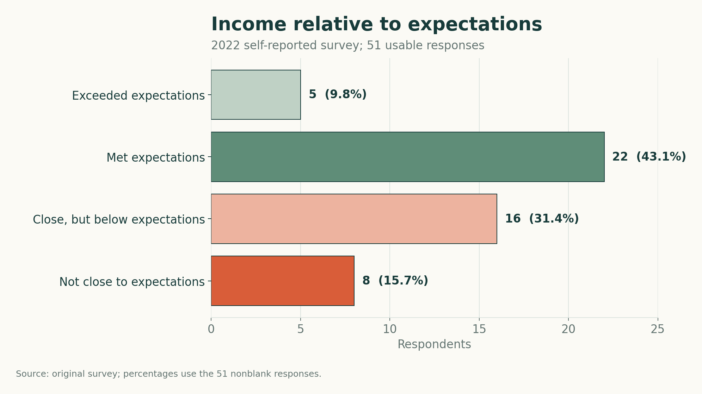
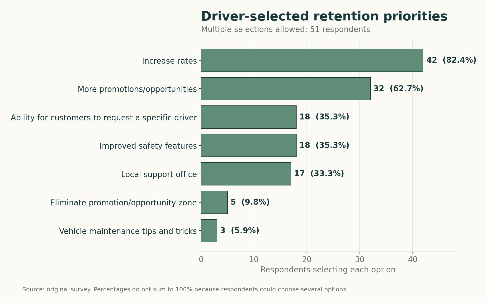
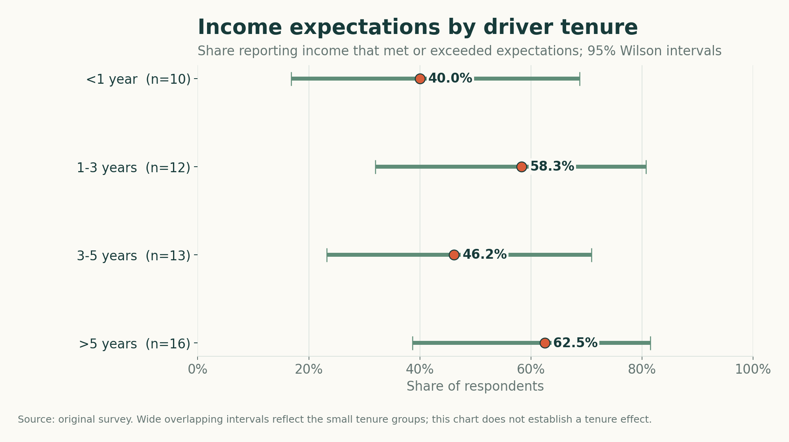

# From Driver Survey to Event-Market Analysis

In 2022, I was driving for Uber while completing my college capstone. The subject was personal: I had seen how sharply driver income and working conditions could vary, and I wanted to understand whether other drivers shared that experience and what they believed Uber could change.

I surveyed drivers recruited through national and regional Facebook groups, analyzed the responses in Excel, and used the findings to propose changes related to earnings, safety, support, and driver retention. This repository preserves that original work and shows how I later extended it with reproducible analysis, public operating data, and stricter limits on what each source can establish.

## Start Here

The portfolio case study is [What Event Demand Looks Like From the Driver's Clock](docs/CROSS_CITY_CASE_STUDY.md).

It follows the question from the original 51-response survey through Chicago event-demand analysis and an NYC benchmark that separates approach, pickup-wait, and passenger-trip time. The central finding is that event opportunity cannot be judged reliably from passenger-onboard metrics alone: including the complete completed-trip clock can weaken or reverse the apparent result.

The [methods appendix](docs/METHODS_APPENDIX.md) contains the matching rules, metric definitions, exclusions, QA decisions, and source limitations.

## Original 2022 Capstone

The original paper is included unchanged so the portfolio shows the starting point as well as the later analytical work:

- [Read the original capstone as a PDF](docs/original/2022-uber-capstone-paper.pdf)
- [Download the original Word document](docs/original/2022-uber-capstone-paper.docx)

The paper contains the reasoning, language, charts, and conclusions submitted in April 2022. I have not silently corrected it. The sections below document how I later reexamined the underlying workbook, protected respondent privacy, rebuilt the calculations, and narrowed claims that the available evidence could not support.

## The Question

How did surveyed drivers describe their earnings relative to expectations, and which changes did they believe would improve driver retention?

## Data and Method

- **Collection period:** March-April 2022
- **Submitted rows:** 52
- **Usable responses:** 51 after removing one identifiable author/test row with missing answers
- **Recruitment:** national and regional Facebook groups for Uber drivers
- **Measures:** driving patterns, tenure, weekly hours, gross hourly income ranges before expenses, high-demand events, retention priorities, and income expectations
- **Analysis:** descriptive counts and percentages; multi-select questions are counted by respondents selecting each option

The public dataset removes locations, gender, names, timestamps, submission IDs, and custom free-text comments. See the [data dictionary](DATA_DICTIONARY.md) for the complete transformation record.

## Findings

### Nearly half reported earning less than expected

Twenty-seven of 51 respondents (52.9%) said their income met or exceeded expectations. Twenty-four (47.1%) said it fell below expectations, including eight who selected "not even close."



This result describes the surveyed group. The convenience sample does not support an estimate for all Uber drivers.

### Pay dominated the requested retention changes

Forty-two respondents selected increased rates, and 32 selected more promotions or opportunities. Non-pay concerns also appeared: 18 selected improved safety features, 18 wanted customers to be able to request a specific driver, and 17 selected local support offices.



Respondents could select several answers, so these percentages intentionally overlap. The responses show what drivers preferred; they do not measure whether any option would cause retention or revenue to increase.

### The sample cannot support a firm tenure conclusion

The observed share meeting or exceeding expectations ranged from 40.0% among drivers with less than one year of tenure to 62.5% among drivers with more than five years. Each group contained only 10 to 16 responses, and the uncertainty intervals overlap substantially.



The original capstone stated that tenure did not appear to make a difference. The reanalysis reaches a narrower conclusion: this sample is too small to distinguish a reliable tenure relationship.

## Recommendations, Reframed

The original capstone recommended higher rates and better promotional opportunities alongside stronger safety features and local human support. Those recommendations remain faithful to the survey responses, but they should be treated as hypotheses for further evaluation.

A stronger follow-up study would recruit a broader sample, distinguish gross revenue from expenses and net earnings, and test whether specific policies change retention over time. Market conditions would also need to be modeled directly rather than inferred from a small number of respondents in each city.

## Limitations

- This was a small, self-selected convenience sample recruited through Facebook groups.
- The data is historical and reflects driver experiences in 2022.
- Income was reported in ranges before expenses, so it is not a measure of wages or profit.
- Multiple-response questions produce overlapping counts.
- The study is descriptive and cannot establish that the proposed changes would cause higher retention or revenue.
- Removing granular location and free-text responses protects privacy but limits market-level analysis.

## Reproduce the Analysis

The published summaries and figures are generated from the anonymized CSV.

```powershell
python analysis/analyze_survey.py
python analysis/create_charts.py
python -m unittest discover -s tests
```

The original paper remains unchanged and is included above. The raw survey workbook remains private because it contains submission metadata and identifying free text. [`PROJECT_AUDIT.md`](PROJECT_AUDIT.md) records the differences between the academic submission and this portfolio reconstruction. [`analysis/analyze_survey.py`](analysis/analyze_survey.py) produces the summary tables, while [`scripts/build_public_dataset.py`](scripts/build_public_dataset.py) documents how private fields and free text were removed.

## Three-City Extension

The extension connects the original driver perspective to complementary evidence from Nashville, Chicago, and New York City. The cities are not pooled or forced into a ranking:

- **Nashville** supplies the originating Uber-driving experience and local context in a market where this project identified no NYC-style municipal driver-pay formula.
- **Chicago** supplies repeated event demand and passenger-trip conditions near Wrigley Field. Illinois created a sectoral bargaining framework on August 7, 2026, after most dates in the panel; the records are not treated as outcomes of a negotiated agreement.
- **New York City** supplies request, arrival, pickup, drop-off, and reported driver-pay fields inside a market with a TLC minimum per-trip payment standard.

Chicago showed that pickup demand concentrated sharply in the event core late in games. NYC then showed why that result is incomplete: in the Yankee Stadium one-mile ring, occupied-only pay per hour was 0.5% higher than matched controls while full-cycle pay per hour was 1.6% lower after approach time increased 17.4%.

A strategy-specific pregame test then examined the Nashville-inspired idea of capturing event pricing while accepting trips moving away from stadium congestion. NYC did not reproduce that mechanism: spillover-away cycles were 7.2% shorter, but adjusted driver pay was unchanged, passenger base fare was 2.8% lower, and trip volume was 5.0% lower than normal. NYC's regulated payment floor can compress variation in reported driver pay, so this is a regulated-market benchmark rather than a clean Nashville transfer test.

See the [cross-city case study](docs/CROSS_CITY_CASE_STUDY.md), [analysis design](docs/THREE_CITY_EXTENSION.md), [methods appendix](docs/METHODS_APPENDIX.md), and [source registry](config/source_registry.csv).

## Repository Structure

| Path | Purpose |
|---|---|
| `data/` | Anonymized public survey responses |
| `analysis/` | Reproducible summary and chart generation |
| `outputs/` | Generated analytical tables |
| `docs/images/` | Generated portfolio figures |
| `docs/original/` | Unchanged 2022 capstone paper in PDF and Word formats |
| `docs/CROSS_CITY_CASE_STUDY.md` | Portfolio-ready analytical narrative |
| `docs/METHODS_APPENDIX.md` | Definitions, matching, QA, and limitations |
| `config/` | Source registry and analytical scope controls |
| `tests/` | Checks for headline counts and privacy exclusions |

