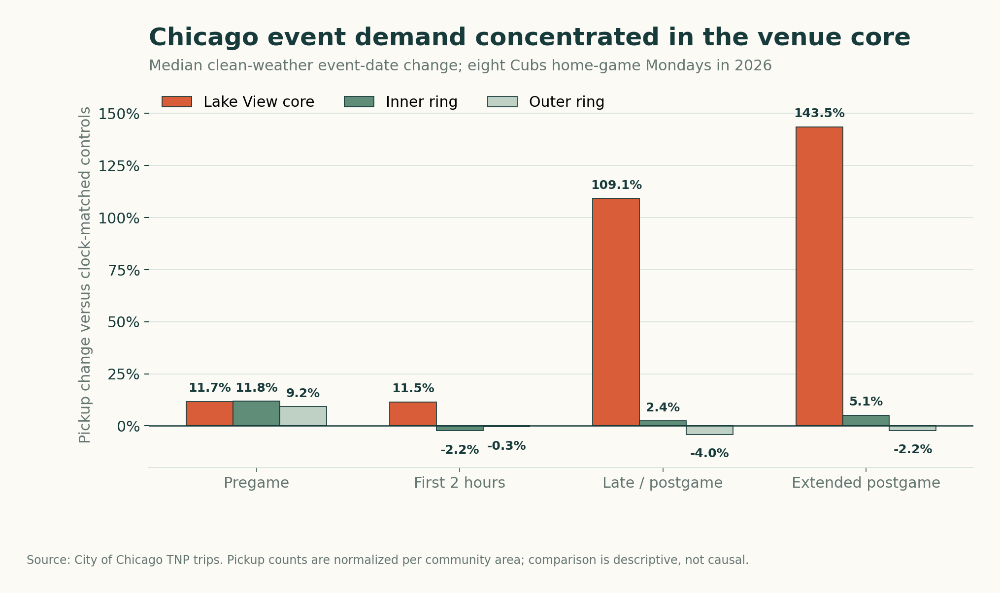
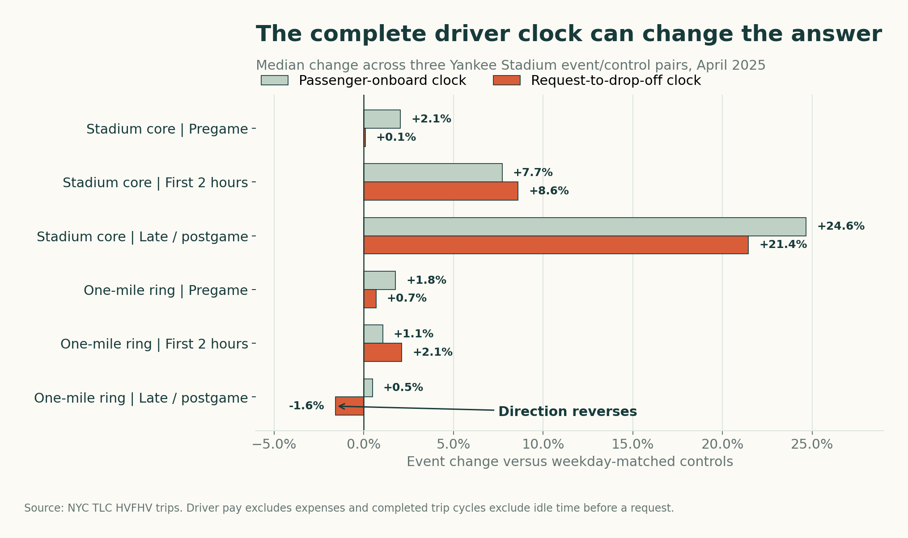
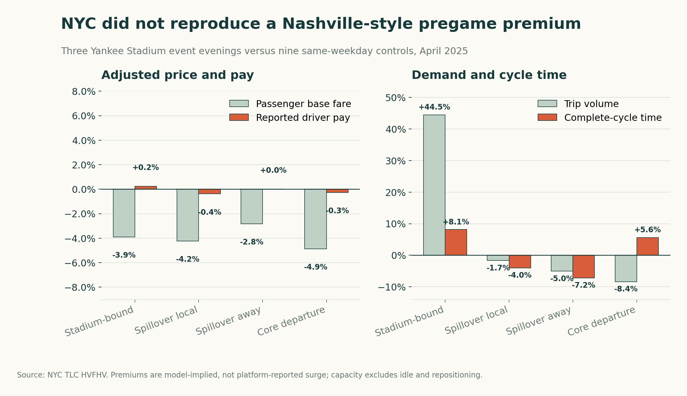
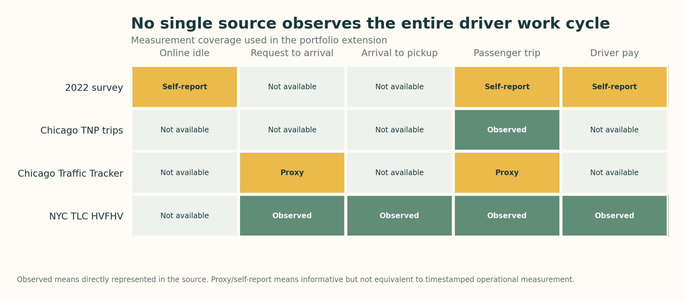

# What Event Demand Looks Like From the Driver's Seat

## Executive answer

Event demand can create substantial rideshare opportunity, but passenger-trip metrics alone do not show whether that opportunity is attractive to a driver. The missing time before pickup can materially weaken or even reverse the apparent result.

This conclusion grew from a question I first investigated while driving for Uber in Nashville and completing my 2022 capstone. The original survey documented driver concerns about earnings and retention. The modern extension then used public data from Chicago and New York City to test what larger operational datasets could and could not reveal.

The evidence does not support a universal rule such as "work the event core" or "avoid the event core." It supports a measurement rule: evaluate the complete driver cycle, keep city-specific operating conditions separate, and do not relabel passenger fares or occupied-trip performance as driver earnings.

The Nashville strategy that motivated the latest test is more specific: during the two-hour pregame window when a driver expects surge pricing, accept pickups inside the event-influenced area but chooses destinations moving away from stadium traffic. The expected benefit is both an event premium and enough saved time to complete more rides before the window closes.

## The progression

### 1. Drivers identified an earnings problem

The original study contained 51 usable self-selected survey responses. Twenty-four respondents (47.1%) said their income fell below expectations. Forty-two selected increased rates as a retention priority, and 32 selected more promotions or opportunities.

Those responses established a genuine question, not a representative estimate of all Uber drivers. The sample was small, recruited through Facebook groups, and reported gross income in ranges before expenses. The modern work preserves the original paper and narrows claims the evidence cannot support.

### 2. Chicago showed when event demand materialized

The Chicago extension examined Monday evening rideshare activity near Wrigley Field in 2026. Across all 22 published Mondays, Cubs home-game dates had 48.5% more trips than controls; the bootstrap interval ranged from 39.2% to 58.5%. Sensitivity estimates remained positive after removing weather-stress dates, holidays, and an anomalous date.

The spatial and event-time analysis showed that the largest pickup increase appeared in the Lake View core late in the game and after it. Adjacent zones did not capture a comparable demand increase.

That finding was not sufficient to recommend the core. Chicago trip records begin when the passenger trip begins. They do not report when a driver accepted the request, how long it took to reach the passenger, or how long the driver waited at pickup.

An April Traffic Tracker validation added arterial-road speeds but found no broad event-night slowdown in the available segment data. That narrowed the congestion claim without resolving side-street delay, pickup queues, closures, or dispatch-to-pickup travel. It also remained a one-event-date validation because the traffic archive ended on April 30, 2026.

### 3. NYC revealed what the missing clock can change

NYC's High-Volume For-Hire Vehicle records include request, driver-arrival, pickup, drop-off, and reported driver-pay fields. Three April 14-16, 2025 Yankee Stadium home games were paired by weekday with April 7-9 controls.

In the stadium core during the late-game/postgame phase, trip volume rose 162.9%. Approach time rose 97.0%, yet full-cycle pay per hour still increased 21.4%. Stronger trip-level compensation was large enough to overcome the observed pre-pickup burden in that phase.

The adjacent one-mile ring produced the more important measurement lesson. Occupied-only pay per hour was 0.5% higher than controls, but approach time rose 17.4% and full-cycle pay per hour fell 1.6%. An occupied-trip metric alone gave the wrong directional answer.

Pregame in the stadium core showed a milder version of the same problem: occupied pay per hour increased 2.1%, while full-cycle pay per hour was nearly unchanged at 0.1% after pickup waiting increased 13.2%.

## A direct test of the surge-spillover strategy

The first NYC benchmark grouped trips by pickup area. A second analysis was designed around the actual Nashville strategy: two hours before the event, compare trips from the one-mile spillover area that end at the stadium, remain local, or move away from the stadium.

Three Yankees home-game evenings were compared with nine same-weekday April evenings when the Yankees were away. Normal passenger-fare and driver-pay models were trained only on controls and adjusted for platform, pickup zone, weekday, 15-minute interval, miles, occupied time, approach time, pickup waiting, and trip direction.

NYC did not reproduce the expected spillover premium. For spillover-away trips, adjusted passenger base fare was 2.8% lower than normal, reported driver pay was effectively unchanged, and volume was 5.0% lower. Complete-cycle time was 7.2% shorter, so the operational-efficiency portion of the hypothesis appeared, but the event-pricing and demand portions did not.

Stadium-bound trips showed the opposite demand pattern: volume increased 44.5% and complete-cycle time increased 8.1%, while adjusted passenger fare fell 3.9% and driver pay was nearly unchanged.

This does not disprove the Nashville strategy. NYC's TLC rules establish a minimum per-trip driver payment based in part on minutes and miles. That floor can compress variation in reported driver pay even when passenger prices or platform incentives change. NYC's event geography and transit system also differ, and the data do not expose the app's displayed surge multiplier. The result is therefore evidence about the strategy inside a regulated market, not a clean test of how it would perform in Nashville.

## Why the cities are not pooled

Nashville, Chicago, and New York City contribute different evidence. Nashville supplies the originating operating experience and local context. Chicago supplies repeated event demand and passenger-trip conditions. NYC supplies the complete completed-trip clock and reported driver pay inside a regulated market.

Pooling those records would manufacture comparability that does not exist. Street networks, transit use, event management, platform behavior, regulation, and available measures differ across cities.

The institutional contrast is time-specific. This project identified no Nashville equivalent to NYC's TLC minimum per-trip payment rule. Illinois enacted the Transportation Network Driver Labor Relations Act on August 7, 2026, creating a process for rideshare drivers to select representatives and bargain on a statewide sectoral basis. That is not the same as showing that drivers in the earlier Chicago panel were already covered by a negotiated agreement. NYC's result is driven by a longstanding municipal pay standard, not merely by describing drivers as unionized.

The NYC hourly figures are not shift-level wages. They omit time logged in before a request and do not subtract fuel, depreciation, insurance, maintenance, taxes, or other expenses. Chicago passenger fares are not driver pay. The Nashville public evidence is contextual rather than trip-level microdata.

## What I would do with better data

A production study should measure the entire operating cycle within one market:

1. Time logged in before a request.
2. Request acceptance to arrival at pickup.
3. Arrival to passenger pickup.
4. Pickup to clearing the event area.
5. Remaining passenger-trip time.
6. Driver pay, incentives, tips, and operating expenses.

For Nashville, the most credible next extension would be a prospective, privacy-preserving personal trip log paired with event schedules and traffic conditions. Rider identities and exact addresses would be excluded, and results would be aggregated before publication.

## Portfolio conclusion

The original capstone asked what drivers wanted Uber to change. The extension asks a harder question: what can the available data actually establish about the operating conditions behind those concerns?

The answer is intentionally qualified. Events can generate meaningful demand and compensation, but the conclusion depends on geography, timing, and whether unpaid or pre-pickup work is included. A trustworthy analysis must show both the observed opportunity and the work the source leaves invisible.

For definitions, exclusions, matching rules, and source details, see the [methods appendix](METHODS_APPENDIX.md).
